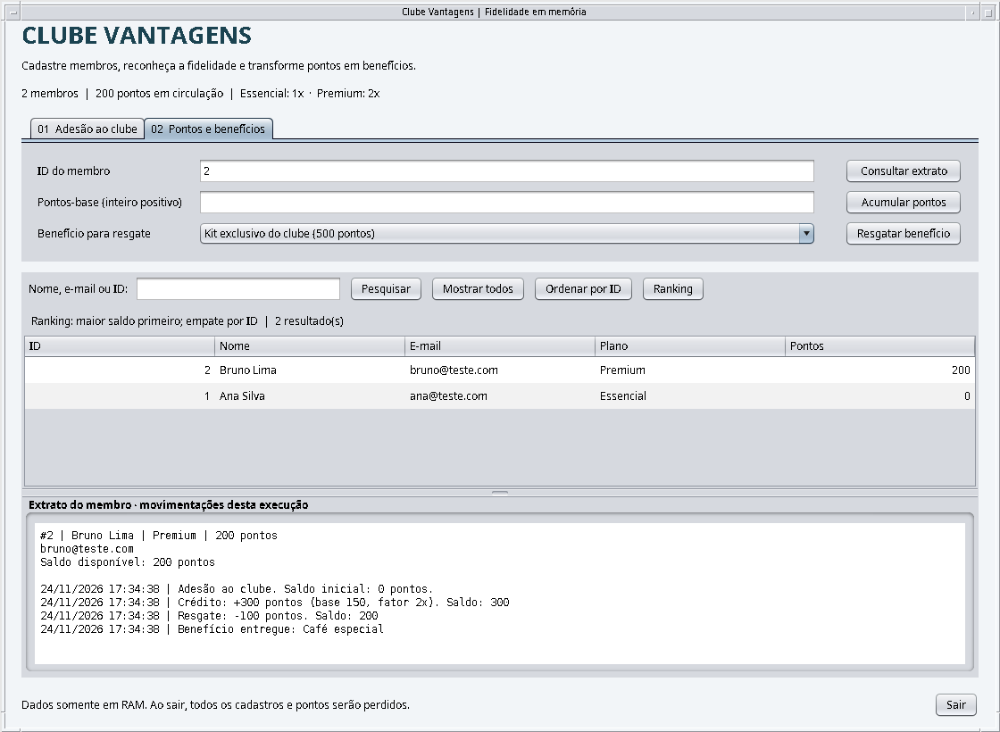
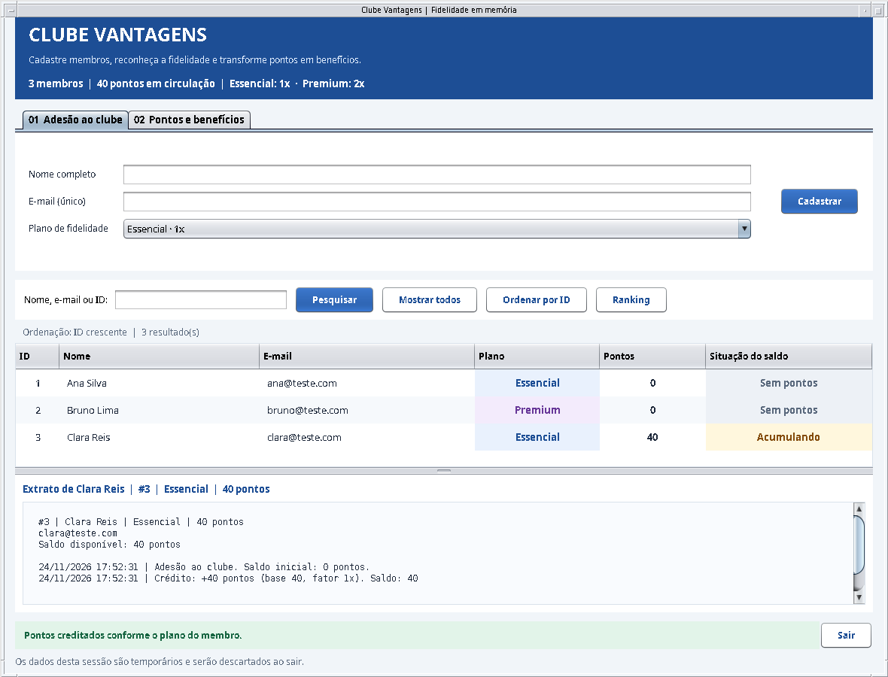
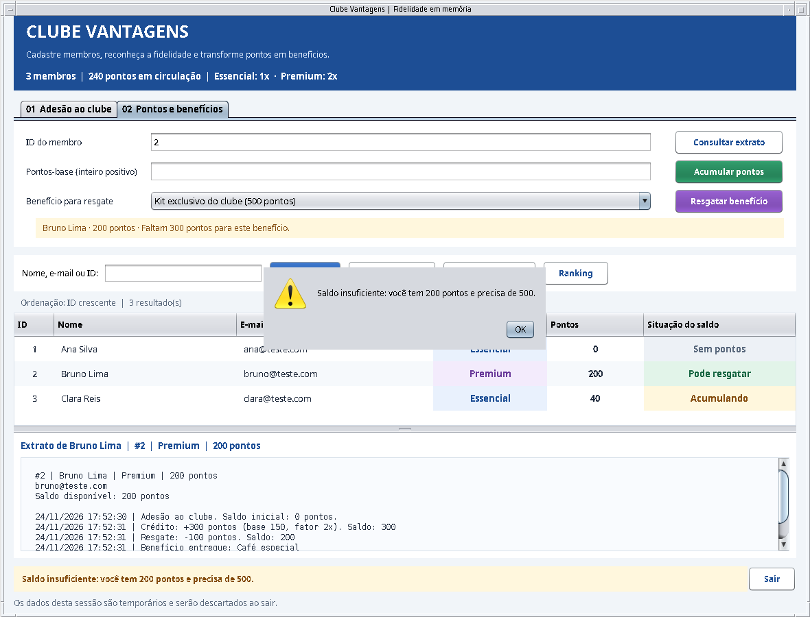

<div align="center">

# Clube Vantagens

### Fidelidade que se transforma em benefícios.

**Cadastre. Bonifique. Resgate. Acompanhe.**

Uma aplicação desktop para gerenciar membros e recompensas, com dois planos de fidelidade, ranking de pontos e extratos de movimentação.


[Conheça o sistema](#o-sistema-em-ação) · [Funcionalidades](#o-que-você-pode-fazer) · [Executar](#como-executar) · [Arquitetura](#arquitetura)

</div>



## A proposta

O Clube Vantagens reúne em uma única janela o ciclo de um programa de fidelidade: adesão de membros, acúmulo de pontos, escolha de benefícios e acompanhamento dos saldos. Cada operação atualiza a listagem, os indicadores e o histórico do membro.

Desenvolvido para a **P2 prática de Programação Orientada a Objetos**, da Fatec Mogi Mirim, com o Prof. Mestre Marcos Roberto de Moraes (Maromo). **Tema 07 — Clube de Assinaturas e Fidelidade**, com base no enunciado da atividade e nos tópicos POO_07 a POO_10.

<div align="center">

<h3>Integrantes</h3>

<table>
  <tr>
    <td align="center" width="360">
      <br>
      <strong>Felipe Augusto Ribeiro Serra</strong>
      <br><br>
    </td>
    <td align="center" width="360">
      <br>
      <strong>Diogo Americo Cavenaghi</strong>
      <br><br>
    </td>
  </tr>
</table>

</div>

## O que você pode fazer

| Recurso | Na prática |
| --- | --- |
| **Adesão ao clube** | Cadastre nome e e-mail, escolha o plano e receba um ID sequencial. |
| **Dois planos** | Essencial acumula 1 ponto por ponto-base; Premium acumula 2. |
| **Resgate de benefícios** | Troque o saldo por café especial, vale-presente ou kit exclusivo. |
| **Ranking atualizado** | Veja os maiores saldos primeiro, com desempate por ID crescente. |
| **Pesquisa rápida** | Localize membros por nome, e-mail ou ID. |
| **Extrato individual** | Consulte créditos, resgates e saldo com data e hora das operações. |
| **Indicadores do clube** | Acompanhe a quantidade de membros e os pontos em circulação. |

## O sistema em ação

As imagens mostram a aplicação Swing executada em uma tela virtual, com dados de demonstração. Os cadastros não são carregados automaticamente ao iniciar o programa.

### 01 · Adesão simples

Nome, e-mail e plano em um formulário direto. A listagem permite consultar os membros e selecionar quem receberá os pontos.



### 02 · Pontos, ranking e extrato

O plano Premium aplica o fator 2x no crédito. No exemplo, 150 pontos-base geram 300 pontos; após resgatar um café de 100 pontos, o membro fica com 200. O extrato apresenta cada etapa.


### 03 · Validação antes do resgate

Se o saldo não cobrir o benefício, a aplicação informa o motivo em um diálogo e preserva os pontos e o histórico.



## Planos e benefícios

| Plano | Multiplicador | Exemplo com 150 pontos-base |
| --- | :---: | :---: |
| Essencial | **1x** | 150 pontos |
| Premium | **2x** | 300 pontos |

| Benefício | Custo |
| --- | ---: |
| Café especial | 100 pontos |
| Vale-presente de R$ 25 | 250 pontos |
| Kit exclusivo do clube | 500 pontos |

Os planos definem o fator de acúmulo; não há cobrança de assinatura. O ranking considera o saldo disponível, portanto os resgates podem mudar a classificação.

## Como executar

Você precisa do **JDK 17 ou superior**, com `java` e `javac` no PATH, e de um ambiente gráfico de desktop. O projeto usa apenas a biblioteca padrão do Java.

**1. Clone e entre no repositório**

```bash
git clone https://github.com/Felipe357/POO-AVALICAO-FINAL.git
cd POO-AVALICAO-FINAL
```

**2. Inicie a aplicação**

Linux ou macOS:

```bash
./executar.sh
```

Windows:

```bat
executar.bat
```

Os scripts compilam as fontes em UTF-8, com compatibilidade Java 17, e abrem a janela principal. Na IDE, configure `src` como pasta de fontes e execute a classe `app.Principal`.

<details>
<summary>Compilação manual pelo terminal</summary>

Crie a pasta `out` e execute na raiz do projeto:

```bash
javac --release 17 -encoding UTF-8 -d out src/app/*.java src/controller/*.java src/exception/*.java src/interfaces/*.java src/model/*.java src/view/*.java
java -cp out app.Principal
```

</details>

> **Dados durante a execução:** os cadastros, saldos e históricos ficam somente em RAM. Ao encerrar, tudo é descartado. A pasta `out/` contém apenas os arquivos de compilação e é ignorada pelo Git.

## Arquitetura

O código separa a interface Swing, a coordenação das operações e as regras do domínio.

```text
src/
├── app/
│   └── Principal.java
├── controller/
│   └── GerenciadorClube.java
├── exception/
│   ├── CadastroInvalidoException.java
│   └── PontuacaoInsuficienteException.java
├── interfaces/
│   └── Bonificavel.java
├── model/
│   ├── Beneficio.java
│   ├── MembroClube.java
│   ├── MembroEssencial.java
│   └── MembroPremium.java
└── view/
    └── TelaClube.java
```

| Camada | Responsabilidade |
| --- | --- |
| `model` | Membros, planos, catálogo de benefícios e regras de crédito e resgate. |
| `interfaces` | Contrato `Bonificavel`, com operações de pontos e consulta de saldo por método `default`. |
| `exception` | Exceções verificadas para cadastro inválido e pontuação insuficiente. |
| `controller` | Lista de membros, IDs, pesquisa, ordenação, operações e montagem dos extratos. |
| `view` | Formulários, listagem, eventos de clique e mensagens ao usuário. |
| `app` | Inicialização na Event Dispatch Thread e abertura da janela. |

### Conceitos de POO aplicados

| Requisito | Implementação |
| --- | --- |
| **Encapsulamento** | Campos privados, acesso por métodos e alteração do saldo somente pelas operações de negócio. |
| **Herança e polimorfismo** | `MembroEssencial` e `MembroPremium` especializam `MembroClube` e definem os fatores 1x e 2x. |
| **Interface de negócio** | `MembroClube` implementa `Bonificavel`; o controlador utiliza esse contrato no acúmulo. |
| **Checked exceptions** | As duas exceções customizadas herdam diretamente de `Exception`; a tela apresenta as mensagens por `JOptionPane`. |
| **Collections e generics** | `List<MembroClube> membros = new ArrayList<>()`, sem banco ou arquivos de dados. |
| **Ordenação natural** | `Comparable<MembroClube>` ordena por ID, aplicado com `Collections.sort()`. O ranking acrescenta um `Comparator` por saldo. |
| **Identidade dos objetos** | `equals()`, `hashCode()` e `compareTo()` usam o ID imutável. |
| **Eventos Swing** | `ActionListener` nos botões e `WindowAdapter`, que implementa `WindowListener`, no fechamento. |
| **Conversão numérica** | Captura de `NumberFormatException` nos campos de ID e pontos. |

### Regras que preservam os dados

- Nome com pelo menos três caracteres e e-mail com validação básica de formato.
- E-mail único, normalizado, sem diferenciar maiúsculas de minúsculas.
- Pontos-base inteiros e positivos, com proteção contra estouro do limite de `int`.
- Resgates sem saldo suficiente não alteram o membro.
- Listas retornadas pelo controlador e pelo histórico não permitem inclusão ou remoção externa.
- Botão Sair e fechamento pelo X pedem confirmação antes de descartar a sessão.

## Exemplo de uso de IA no desenvolvimento

<details>
<summary>Consultar dúvidas e soluções</summary>

### 1. Ordenação dos membros

**Aluno:** Já tenho a classe `MembroClube` com ID e saldo de pontos. Quero listar por ID e também mostrar um ranking por saldo. Preciso mudar o `compareTo()` para cada caso?

**IA:** Mantenha a ordem natural por ID em `Comparable<MembroClube>` e use um `Comparator` para o ranking. Assim, cada critério fica explícito e você pode desempatar pelo ID.

```java
// Ordem natural definida em MembroClube.
@Override
public int compareTo(MembroClube outro) {
    return Integer.compare(getId(), outro.getId());
}

// Ranking aplicado pelo controlador sobre uma cópia da lista.
Collections.sort(ordenados, Comparator.comparingInt(MembroClube::getPontos)
        .reversed()
        .thenComparingInt(MembroClube::getId));
```

### 2. Saldo insuficiente no resgate

**Aluno:** Implementei o desconto de pontos, mas preciso impedir o resgate quando o saldo for insuficiente. Onde devo lançar a exceção e onde mostro a mensagem?

**IA:** Valide o saldo no domínio antes de descontar os pontos. Lance `PontuacaoInsuficienteException`, herdando de `Exception`, e capture na tela para apresentar `ex.getMessage()` em um `JOptionPane`. Dessa forma, a regra de negócio não depende do Swing.

```java
// Dentro do método de resgate da entidade.
if (quantidade > pontos) {
    throw new PontuacaoInsuficienteException(
            "Saldo insuficiente: você tem " + pontos
                    + " pontos e precisa de " + quantidade + ".");
}
pontos -= quantidade;
```

### 3. Pontuação diferente por plano

**Aluno:** Os membros Essencial e Premium já herdam de `MembroClube`. Quero que o Premium receba o dobro de pontos sem colocar vários `if` no controlador. Como organizar isso?

**IA:** Declare um método abstrato `getMultiplicador()` na classe base e sobrescreva nas subclasses, retornando 1 ou 2. O método de acúmulo utiliza esse fator. No controlador, trabalhe com o contrato `Bonificavel`; o comportamento do plano é resolvido pelo polimorfismo.

```java
Bonificavel participante = buscarPorId(id);
participante.acumularPontos(pontosBase);
```

### 4. Preencher o ID pela seleção da tabela

**Aluno:** A tela já tem uma `JTable` e um campo para o ID da operação. Pode ajudar com um evento curto para preencher esse campo quando eu selecionar um membro?

**IA:** Adicione um listener ao modelo de seleção. Verifique se existe uma linha selecionada antes de consultar a primeira coluna, que contém o ID. No código abaixo, a tabela utiliza diretamente a ordem do modelo, sem `RowSorter`.

```java
tabela.getSelectionModel().addListSelectionListener(evento -> {
    if (!evento.getValueIsAdjusting() && tabela.getSelectedRow() >= 0) {
        id.setText(modelo.getValueAt(tabela.getSelectedRow(), 0).toString());
    }
});
```

### 5. Evitar e-mails duplicados

**Aluno:** A validação de e-mail já está funcionando, mas ainda consigo cadastrar a mesma pessoa usando letras maiúsculas ou espaços nas pontas. Como evito essa duplicidade na lista em memória?

**IA:** Compare o e-mail informado com os existentes usando `trim()` e `equalsIgnoreCase()` antes de inserir o membro. Na entidade, armazene o e-mail normalizado com `toLowerCase(Locale.ROOT)`. Mantenha também a validação de formato para rejeitar entradas inválidas.

```java
for (MembroClube membro : membros) {
    if (email != null && membro.getEmail().equalsIgnoreCase(email.trim())) {
        throw new CadastroInvalidoException(
                "Este e-mail já pertence a um membro do clube.");
    }
}
```

</details>

---

<div align="center">

**Clube Vantagens · POO · Fatec Mogi Mirim**

Felipe Augusto Ribeiro Serra & Diogo Americo Cavenaghi

</div>
